# Índice visual

As miniaturas abaixo são links diretos para os PNGs completos. O [catálogo JSON](./catalog.json) contém os metadados das capturas.

## 01 — Login e acesso

Autenticação operacional e administrativa.

### Login da oficina

Tela inicial de autenticação, sem usuário ou senha preenchidos.

[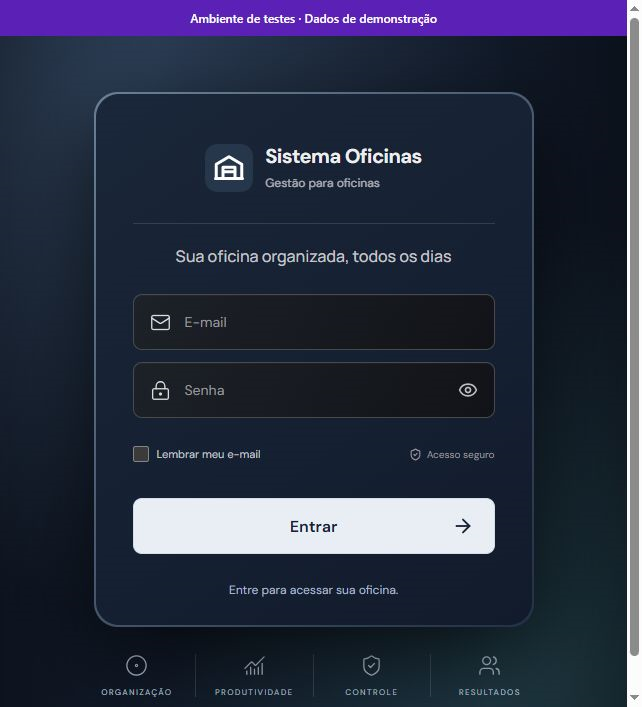](./capturas/01-login-acesso/login-oficina.png)

Estado: capturada · mobile · captura 2026-10-22 · commit de origem: não registrado · [arquivo completo](./capturas/01-login-acesso/login-oficina.png)

## 02 — Dashboard

Início, visão geral, indicadores e atalhos.

### Início da Oficina Fictícia A

Menu e atalhos da conta de demonstração.

[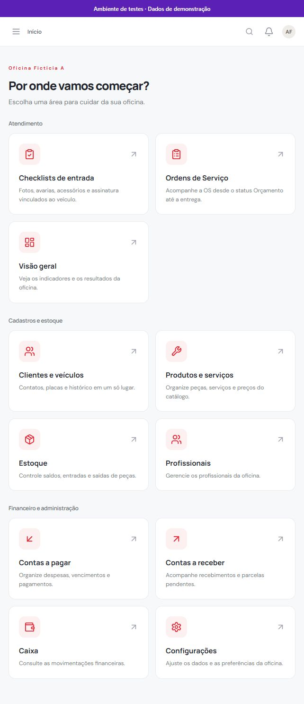](./capturas/02-dashboard/inicio-oficina.png)

Estado: capturada · mobile · captura 2026-10-22 · commit de origem: não registrado · [arquivo completo](./capturas/02-dashboard/inicio-oficina.png)

### Visão geral da Oficina Fictícia A

Indicadores vazios da oficina de teste.

Estado: capturada · mobile · captura 2026-10-22 · commit de origem: não registrado · [arquivo completo](./capturas/02-dashboard/dashboard-oficina.png)

### Início da Oficina Fictícia B

Menu e atalhos em uma segunda conta fictícia.

[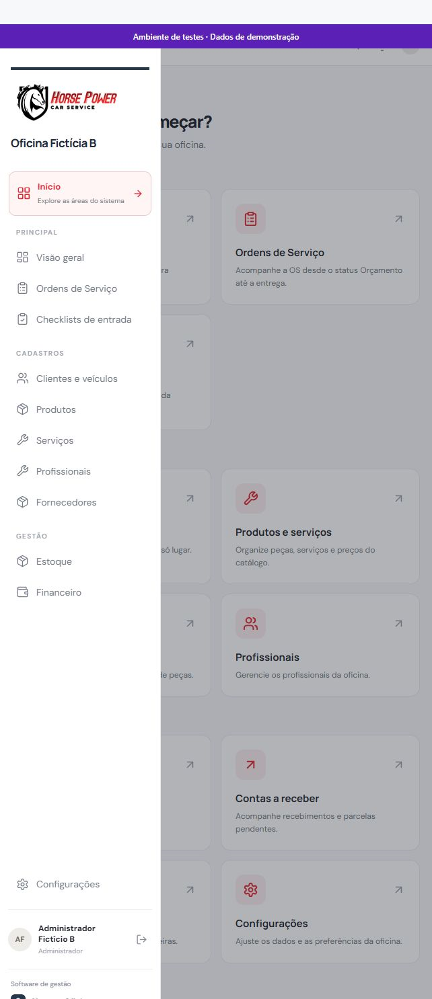](./capturas/02-dashboard/inicio-oficina-oficina-b.png)

Estado: capturada · mobile · captura 2026-10-22 · commit de origem: não registrado · [arquivo completo](./capturas/02-dashboard/inicio-oficina-oficina-b.png)

### Visão geral da Oficina Fictícia B

Indicadores da segunda conta fictícia para referência de isolamento.

[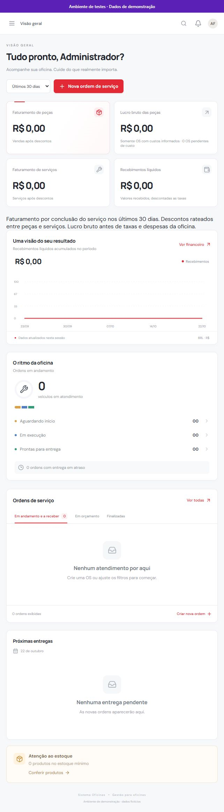](./capturas/02-dashboard/dashboard-oficina-b.png)

Estado: capturada · mobile · captura 2026-10-22 · commit de origem: não registrado · [arquivo completo](./capturas/02-dashboard/dashboard-oficina-b.png)

## 03 — Clientes

Lista, pesquisa, cadastro e edição de clientes.

### Clientes da Oficina Fictícia A

Lista e pesquisa com dados de demonstração.

[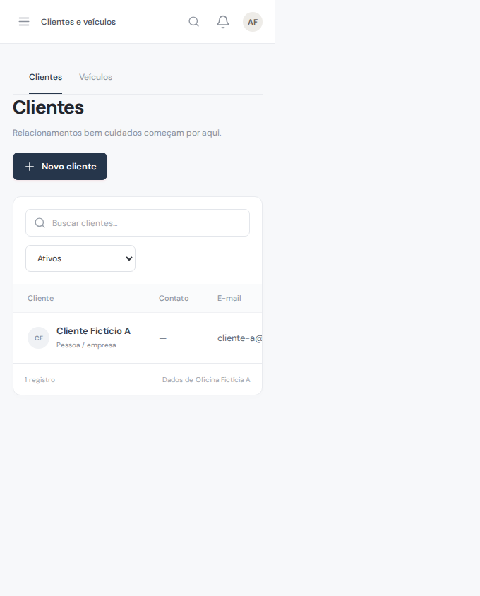](./capturas/03-clientes/clientes-lista-oficina-a.png)

Estado: capturada · mobile · captura 2026-10-22 · commit de origem: não registrado · [arquivo completo](./capturas/03-clientes/clientes-lista-oficina-a.png)

### Clientes da Oficina Fictícia B

Lista da segunda oficina fictícia; não contém registros da Oficina A.

[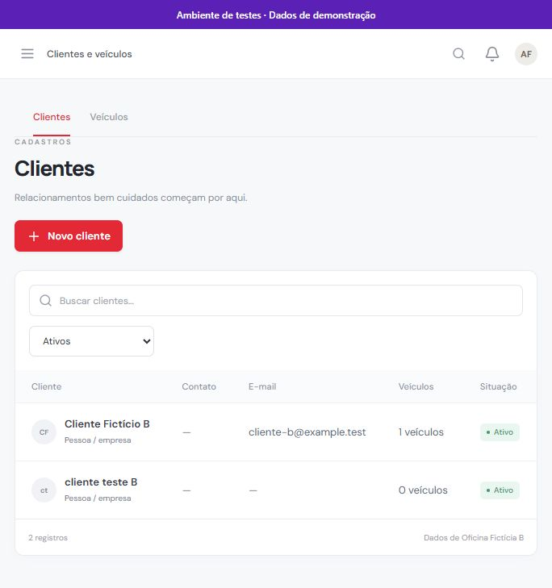](./capturas/03-clientes/clientes-lista-oficina-b.png)

Estado: capturada · mobile · captura 2026-10-22 · commit de origem: não registrado · [arquivo completo](./capturas/03-clientes/clientes-lista-oficina-b.png)

## 04 — Veículos

Lista, pesquisa, seleção e edição de veículos.

### Veículos da Oficina Fictícia A

Lista de veículos e vínculo com cliente fictício.

[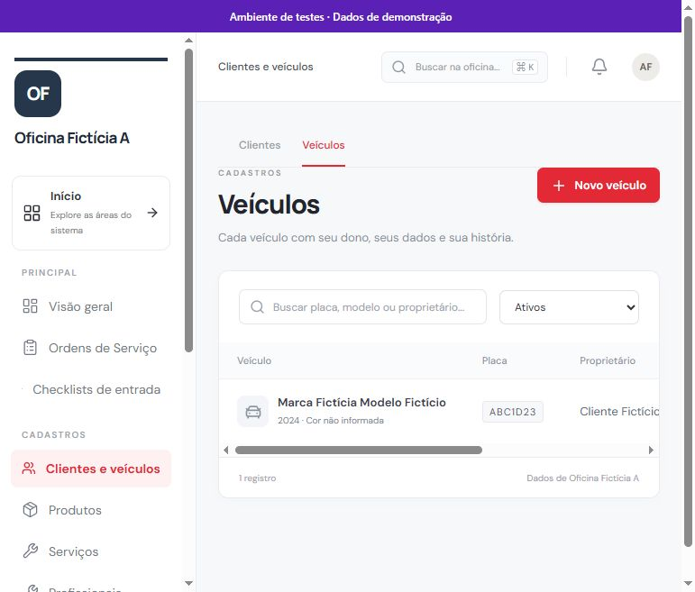](./capturas/04-veiculos/veiculos-lista-oficina-a.png)

Estado: capturada · mobile · captura 2026-10-22 · commit de origem: não registrado · [arquivo completo](./capturas/04-veiculos/veiculos-lista-oficina-a.png)

### Veículos da Oficina Fictícia B

Lista de veículos da segunda oficina fictícia.

[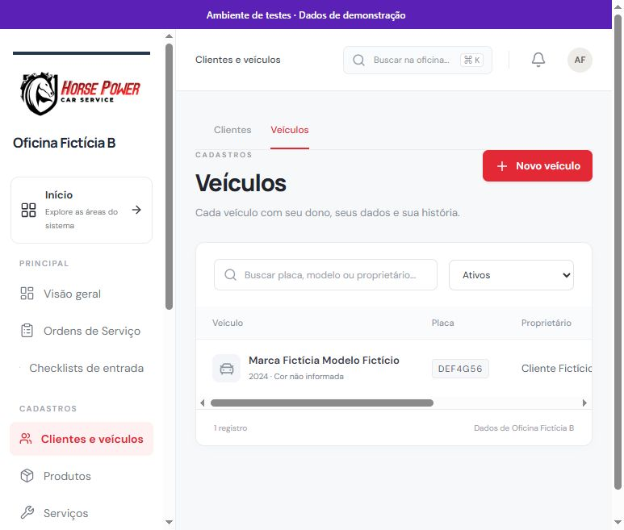](./capturas/04-veiculos/veiculos-lista-oficina-b.png)

Estado: capturada · mobile · captura 2026-10-22 · commit de origem: não registrado · [arquivo completo](./capturas/04-veiculos/veiculos-lista-oficina-b.png)

### CAD-005 — Novo veículo (desktop)

Formulário real com dados fictícios; identificação FIPE independente da associação técnica.

[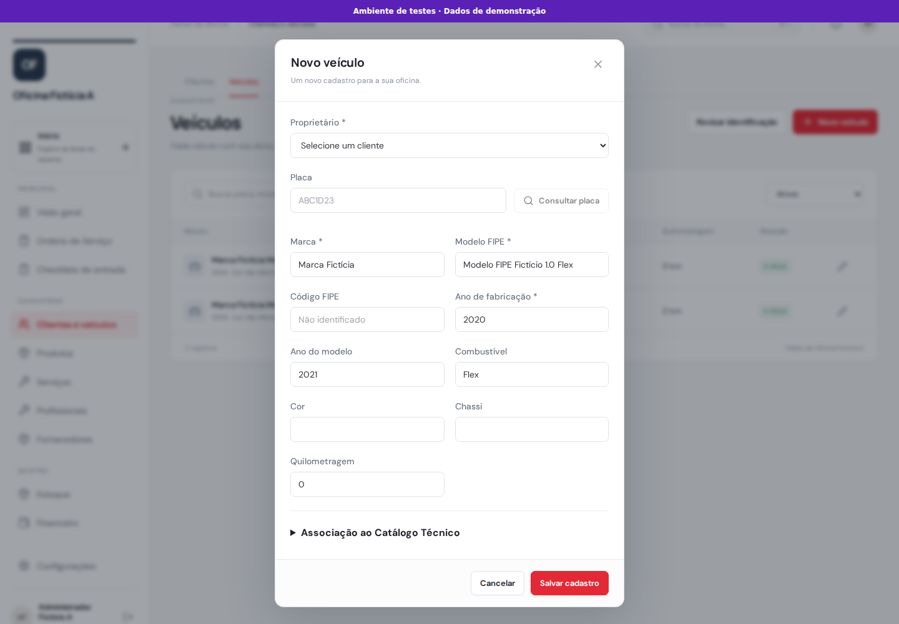](./capturas/04-veiculos/cad005-register-desktop.png)

Estado: capturada · desktop · captura 2026-10-30 · commit de origem: f6e2a4cb13517dc8f57dc1703586ce27268d004c · [arquivo completo](./capturas/04-veiculos/cad005-register-desktop.png)

### CAD-005 — Novo veículo (mobile)

Formulário real com dados fictícios; identificação FIPE independente da associação técnica.

[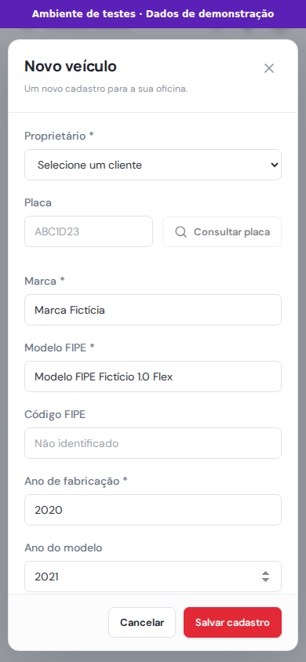](./capturas/04-veiculos/cad005-register-mobile.png)

Estado: capturada · mobile · captura 2026-10-30 · commit de origem: f6e2a4cb13517dc8f57dc1703586ce27268d004c · [arquivo completo](./capturas/04-veiculos/cad005-register-mobile.png)

### CAD-005 — Revisão de veículo (desktop)

Formulário real com dados fictícios; identificação FIPE independente da associação técnica.

[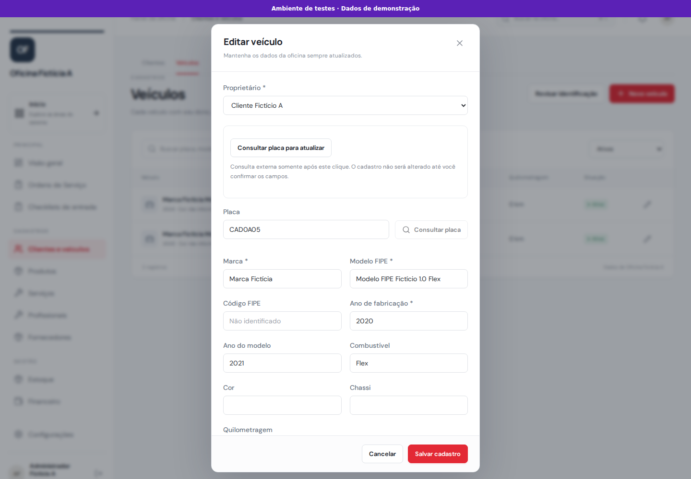](./capturas/04-veiculos/cad005-review-desktop.png)

Estado: capturada · desktop · captura 2026-10-30 · commit de origem: f6e2a4cb13517dc8f57dc1703586ce27268d004c · [arquivo completo](./capturas/04-veiculos/cad005-review-desktop.png)

### CAD-005 — Revisão de veículo (mobile)

Formulário real com dados fictícios; identificação FIPE independente da associação técnica.

[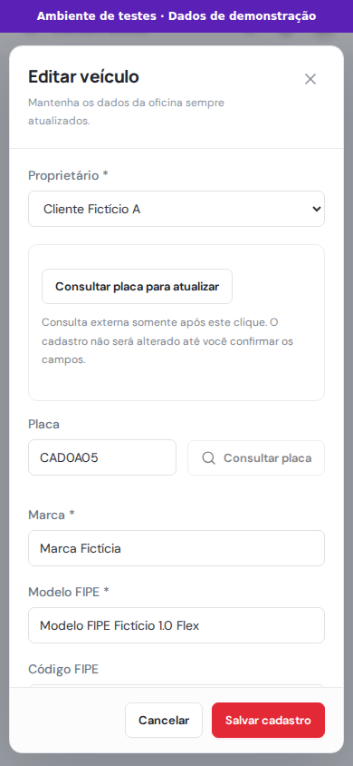](./capturas/04-veiculos/cad005-review-mobile.png)

Estado: capturada · mobile · captura 2026-10-30 · commit de origem: f6e2a4cb13517dc8f57dc1703586ce27268d004c · [arquivo completo](./capturas/04-veiculos/cad005-review-mobile.png)

### CAD-005 — Novo veículo (mobile) — rodapé

Formulário real com dados fictícios; identificação FIPE independente da associação técnica.

[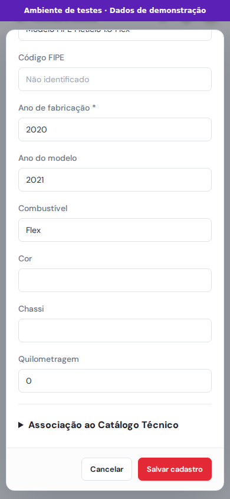](./capturas/04-veiculos/cad005-register-footer-mobile.png)

Estado: capturada · mobile · captura 2026-10-30 · commit de origem: f6e2a4cb13517dc8f57dc1703586ce27268d004c · [arquivo completo](./capturas/04-veiculos/cad005-register-footer-mobile.png)

### CAD-005 — Revisão de veículo (mobile) — rodapé

Formulário real com dados fictícios; identificação FIPE independente da associação técnica.

[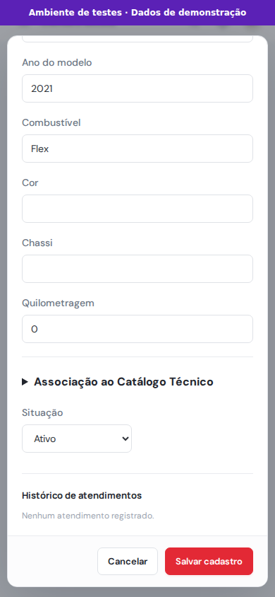](./capturas/04-veiculos/cad005-review-footer-mobile.png)

Estado: capturada · mobile · captura 2026-10-30 · commit de origem: f6e2a4cb13517dc8f57dc1703586ce27268d004c · [arquivo completo](./capturas/04-veiculos/cad005-review-footer-mobile.png)

### CAD-005 — Associação manual no modal (desktop)

Clique real na marca e no modelo, gravação e reabertura do vínculo manual sem alterar a identificação FIPE.

[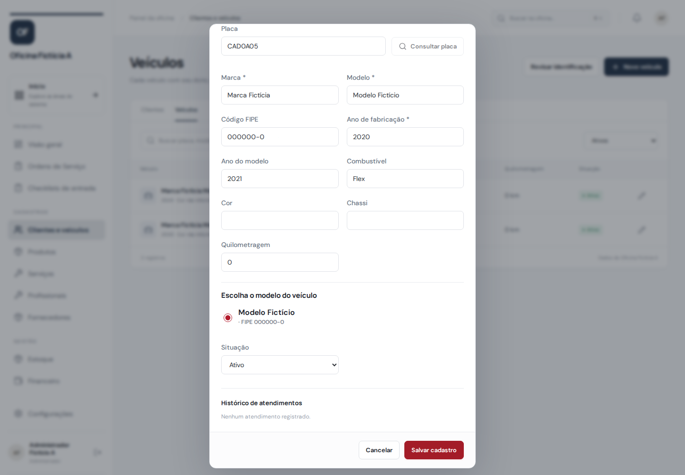](./capturas/04-veiculos/cad005-review-catalog-desktop.png)

Estado: capturada · desktop · captura 2026-10-30 · commit de origem: e5a84d7a9bb11a524307051eb7da7c44bfddd12b · [arquivo completo](./capturas/04-veiculos/cad005-review-catalog-desktop.png)

### CAD-005 — Associação manual no modal (mobile)

Clique real na marca e no modelo, gravação e reabertura do vínculo manual sem alterar a identificação FIPE.

[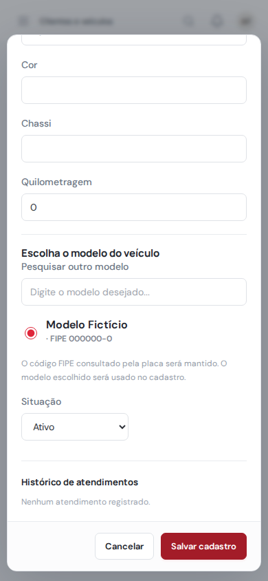](./capturas/04-veiculos/cad005-review-catalog-mobile.png)

Estado: capturada · mobile · captura 2026-10-30 · commit de origem: e5a84d7a9bb11a524307051eb7da7c44bfddd12b · [arquivo completo](./capturas/04-veiculos/cad005-review-catalog-mobile.png)

## 05 — Checklist

Recepção, checklist, evidências e conclusão.

### Lista de checklists

Estado vazio da lista de checklists.

[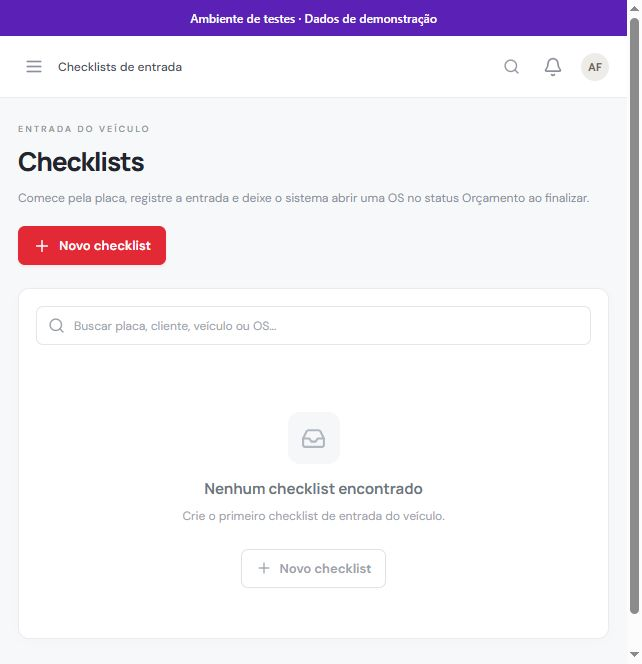](./capturas/05-checklist/lista-checklists.png)

Estado: capturada · mobile · captura 2026-10-22 · commit de origem: não registrado · [arquivo completo](./capturas/05-checklist/lista-checklists.png)

### Novo checklist

Estado inicial do formulário; não foi criado nenhum registro.

[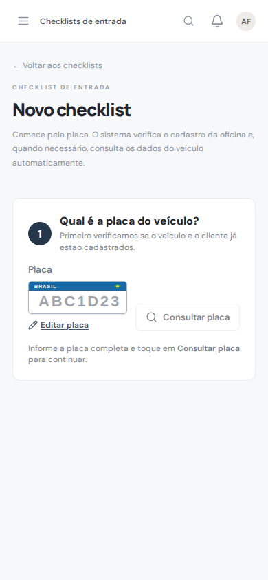](./capturas/05-checklist/novo-checklist.png)

Estado: capturada · mobile · captura 2026-10-22 · commit de origem: não registrado · [arquivo completo](./capturas/05-checklist/novo-checklist.png)

### CAD-005 — Veículo no checklist (desktop)

Formulário real com dados fictícios; identificação FIPE independente da associação técnica.

[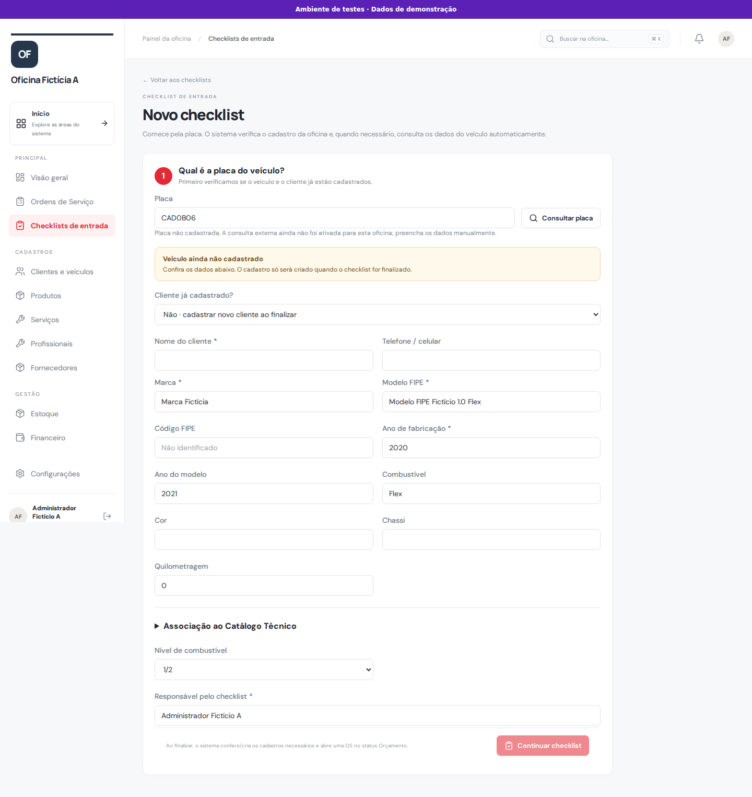](./capturas/05-checklist/cad005-checklist-desktop.png)

Estado: capturada · desktop · captura 2026-10-30 · commit de origem: f6e2a4cb13517dc8f57dc1703586ce27268d004c · [arquivo completo](./capturas/05-checklist/cad005-checklist-desktop.png)

### CAD-005 — Veículo no checklist (mobile)

Formulário real com dados fictícios; identificação FIPE independente da associação técnica.

[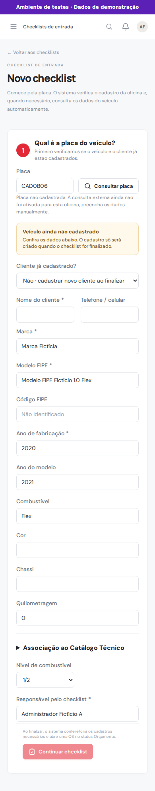](./capturas/05-checklist/cad005-checklist-mobile.png)

Estado: capturada · mobile · captura 2026-10-30 · commit de origem: f6e2a4cb13517dc8f57dc1703586ce27268d004c · [arquivo completo](./capturas/05-checklist/cad005-checklist-mobile.png)

## 06 — Orçamentos

Orçamento dentro do fluxo de atendimento.

### Novo orçamento

Orçamento no fluxo de ordem de serviço, antes de salvar.

Estado: capturada · mobile · captura 2026-10-22 · commit de origem: não registrado · [arquivo completo](./capturas/06-orcamentos/novo-orcamento.png)

### CAD-005 — Veículo na abertura do atendimento (desktop)

Formulário real com dados fictícios; identificação FIPE independente da associação técnica.

[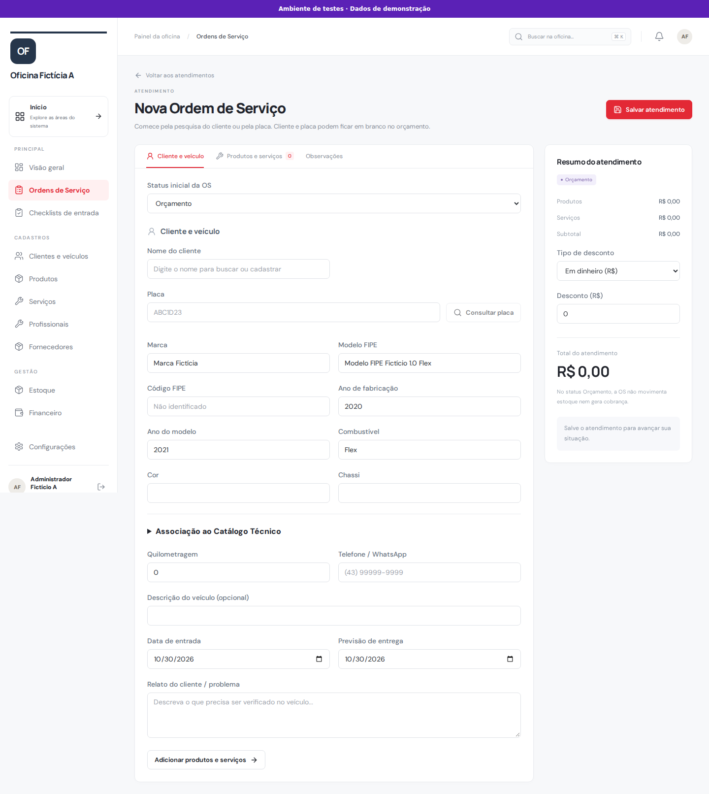](./capturas/06-orcamentos/cad005-order-desktop.png)

Estado: capturada · desktop · captura 2026-10-30 · commit de origem: f6e2a4cb13517dc8f57dc1703586ce27268d004c · [arquivo completo](./capturas/06-orcamentos/cad005-order-desktop.png)

### CAD-005 — Veículo na abertura do atendimento (mobile)

Formulário real com dados fictícios; identificação FIPE independente da associação técnica.

[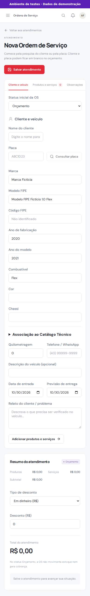](./capturas/06-orcamentos/cad005-order-mobile.png)

Estado: capturada · mobile · captura 2026-10-30 · commit de origem: f6e2a4cb13517dc8f57dc1703586ce27268d004c · [arquivo completo](./capturas/06-orcamentos/cad005-order-mobile.png)

## 07 — Ordens de serviço

Lista, criação, edição, status e recebimento.

### Ordens de serviço da Oficina Fictícia A

Lista vazia na base de demonstração.

[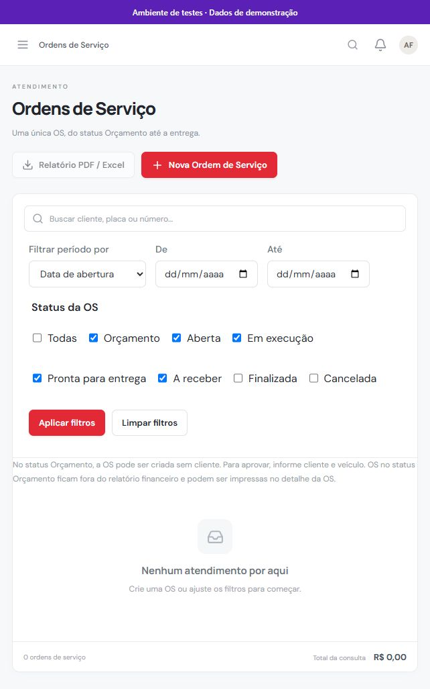](./capturas/07-ordens-servico/lista-os-oficina-a.png)

Estado: capturada · mobile · captura 2026-10-22 · commit de origem: não registrado · [arquivo completo](./capturas/07-ordens-servico/lista-os-oficina-a.png)

### Ordens de serviço da Oficina Fictícia B

Lista vazia da segunda oficina fictícia.

Estado: capturada · mobile · captura 2026-10-22 · commit de origem: não registrado · [arquivo completo](./capturas/07-ordens-servico/lista-os-oficina-b.png)

### Nova ordem de serviço

Formulário inicial; nenhum atendimento foi salvo.

[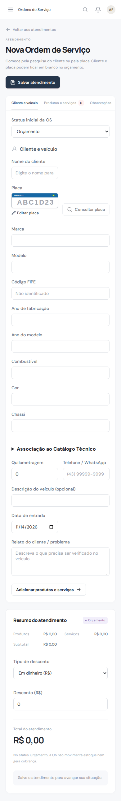](./capturas/07-ordens-servico/nova-os.png)

Estado: capturada · mobile · captura 2026-10-22 · commit de origem: não registrado · [arquivo completo](./capturas/07-ordens-servico/nova-os.png)

### Serviços próprios na OS

Cadastro rápido, pesquisa e edição de serviço fictício em orçamento não salvo.

[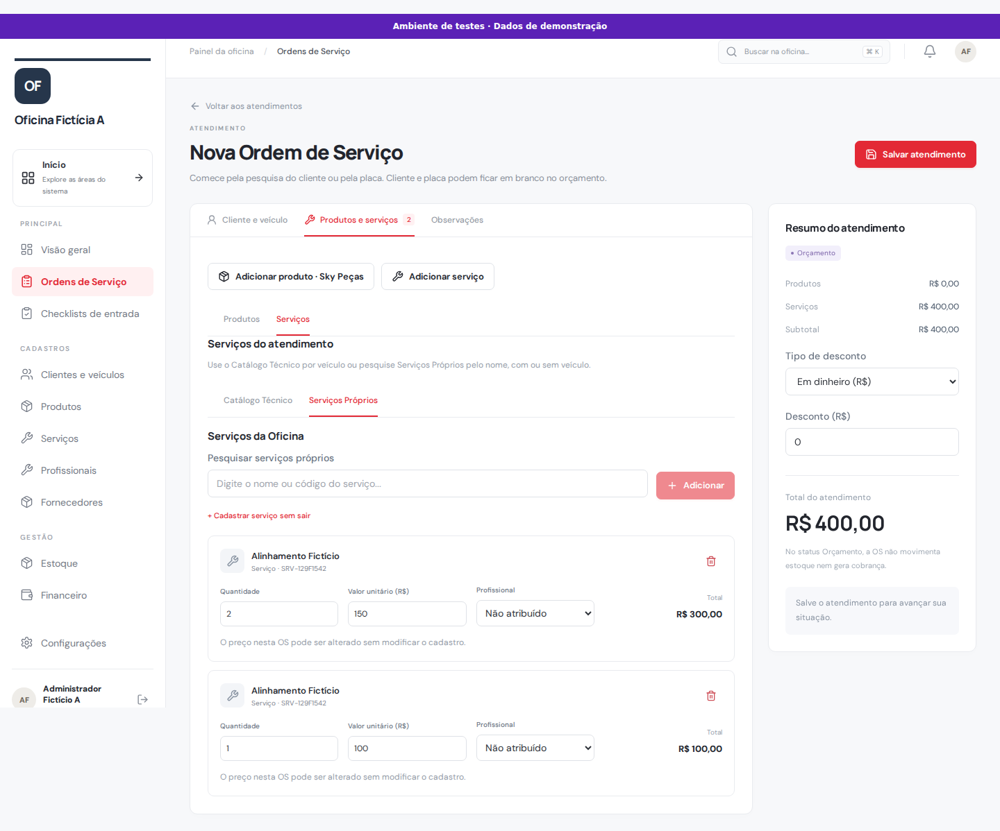](./capturas/07-ordens-servico/est009-os-private-desktop.png)

Estado: capturada · desktop · captura 2026-10-30 · commit de origem: f53519d7d874817dd129414e68789368cef5f170 · [arquivo completo](./capturas/07-ordens-servico/est009-os-private-desktop.png)

### Serviços próprios na OS (celular)

Pesquisa e inclusão de serviço fictício em orçamento não salvo.

[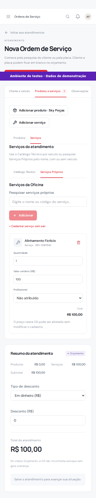](./capturas/07-ordens-servico/est009-os-private-mobile.png)

Estado: capturada · mobile · captura 2026-10-30 · commit de origem: f53519d7d874817dd129414e68789368cef5f170 · [arquivo completo](./capturas/07-ordens-servico/est009-os-private-mobile.png)

### CAD-005 — Troca de veículo no atendimento (desktop)

Formulário real com dados fictícios; identificação FIPE independente da associação técnica.

[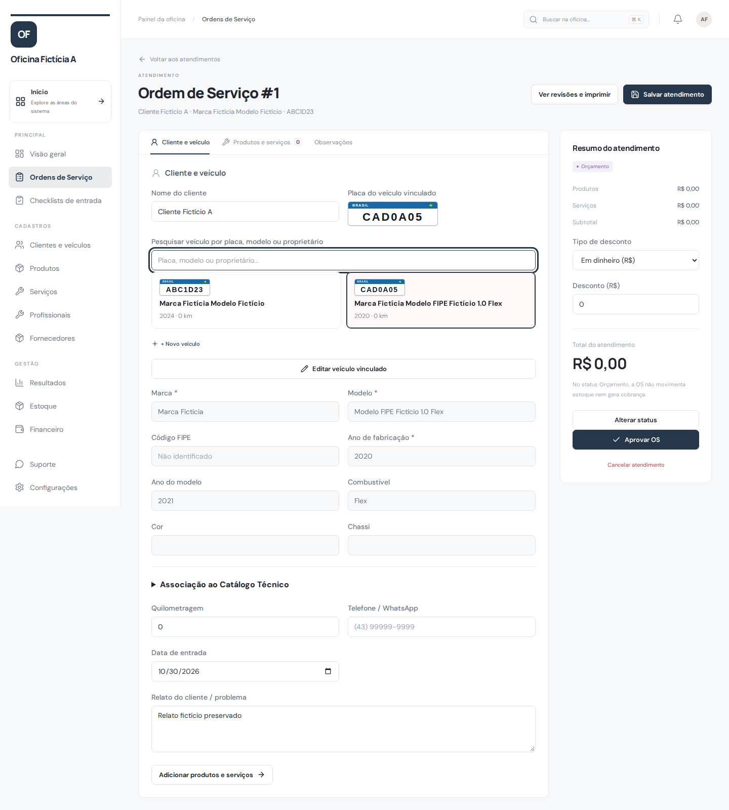](./capturas/07-ordens-servico/cad005-switch-desktop.png)

Estado: capturada · desktop · captura 2026-10-30 · commit de origem: f6e2a4cb13517dc8f57dc1703586ce27268d004c · [arquivo completo](./capturas/07-ordens-servico/cad005-switch-desktop.png)

### CAD-005 — Troca de veículo no atendimento (mobile)

Formulário real com dados fictícios; identificação FIPE independente da associação técnica.

[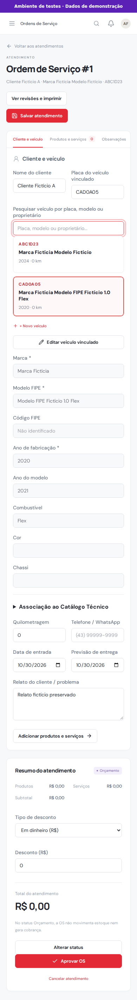](./capturas/07-ordens-servico/cad005-switch-mobile.png)

Estado: capturada · mobile · captura 2026-10-30 · commit de origem: f6e2a4cb13517dc8f57dc1703586ce27268d004c · [arquivo completo](./capturas/07-ordens-servico/cad005-switch-mobile.png)

## 08 — Financeiro

Contas, caixa, recebíveis e relatórios.

### Contas a pagar

Estado sem lançamentos na conta de demonstração.

[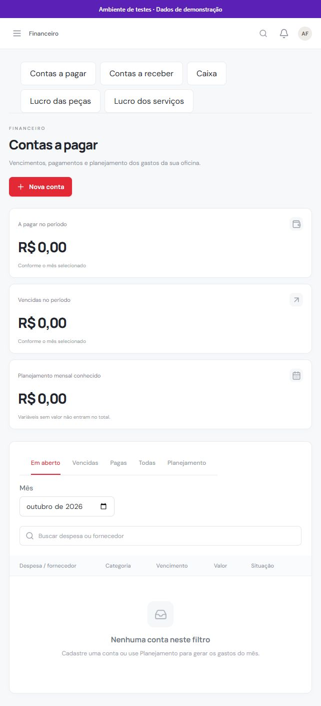](./capturas/08-financeiro/contas-a-pagar.png)

Estado: capturada · mobile · captura 2026-10-22 · commit de origem: não registrado · [arquivo completo](./capturas/08-financeiro/contas-a-pagar.png)

### Contas a receber

Estado sem recebíveis; depende de OS finalizada.

[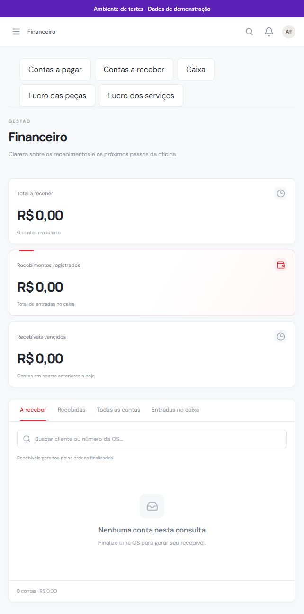](./capturas/08-financeiro/contas-a-receber.png)

Estado: capturada · mobile · captura 2026-10-22 · commit de origem: não registrado · [arquivo completo](./capturas/08-financeiro/contas-a-receber.png)

### Controle de caixa

Contas e movimentos vazios na demonstração.

[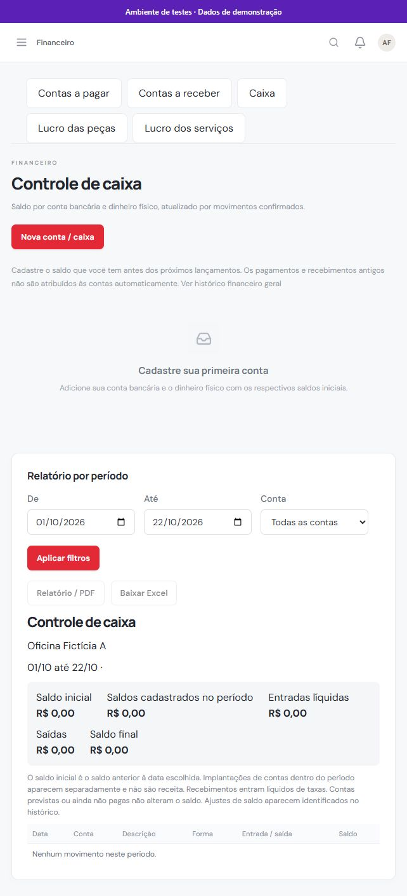](./capturas/08-financeiro/controle-caixa.png)

Estado: capturada · mobile · captura 2026-10-22 · commit de origem: não registrado · [arquivo completo](./capturas/08-financeiro/controle-caixa.png)

### Histórico do caixa

Sem movimentos confirmados na demonstração.

[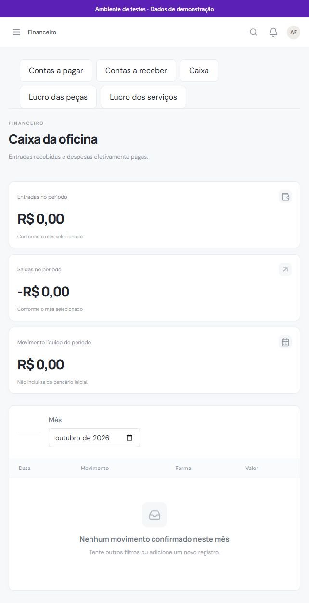](./capturas/08-financeiro/historico-caixa.png)

Estado: capturada · mobile · captura 2026-10-22 · commit de origem: não registrado · [arquivo completo](./capturas/08-financeiro/historico-caixa.png)

### Lucro das peças

Relatório sem vendas no período demonstrado.

[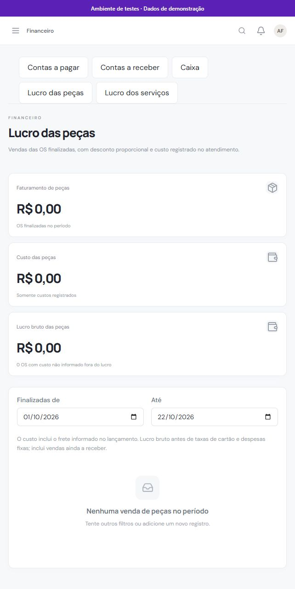](./capturas/08-financeiro/lucro-pecas.png)

Estado: capturada · mobile · captura 2026-10-22 · commit de origem: não registrado · [arquivo completo](./capturas/08-financeiro/lucro-pecas.png)

### Lucro dos serviços

Relatório sem vendas no período demonstrado.

[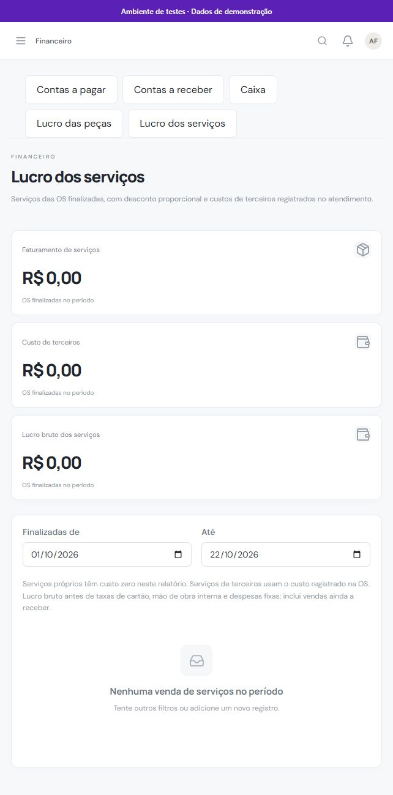](./capturas/08-financeiro/lucro-servicos.png)

Estado: capturada · mobile · captura 2026-10-22 · commit de origem: não registrado · [arquivo completo](./capturas/08-financeiro/lucro-servicos.png)

## 09 — Cadastros e serviços

Produtos, serviços, profissionais e tempos.

### Produtos

Catálogo particular de produtos vazio.

[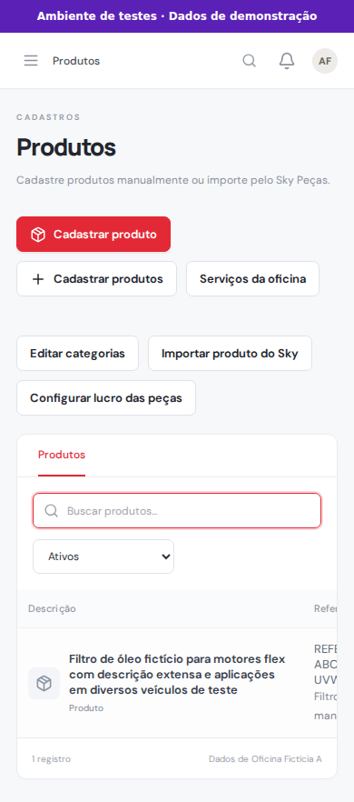](./capturas/09-cadastros-servicos/produtos.png)

Estado: capturada · mobile · captura 2026-10-22 · commit de origem: não registrado · [arquivo completo](./capturas/09-cadastros-servicos/produtos.png)

### Catálogo de tempos

Modelo e serviço fictícios disponíveis para consulta.

[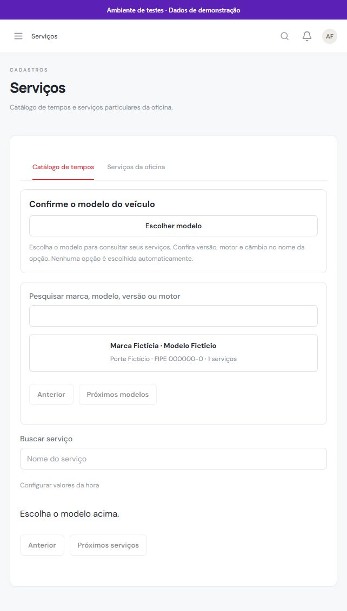](./capturas/09-cadastros-servicos/catalogo-tempos.png)

Estado: capturada · mobile · captura 2026-10-30 · commit de origem: 3792b567510404220727ed26137e813eb84bc96e · [arquivo completo](./capturas/09-cadastros-servicos/catalogo-tempos.png)

### Serviços do modelo fictício

Serviço de demonstração e duração de referência.

[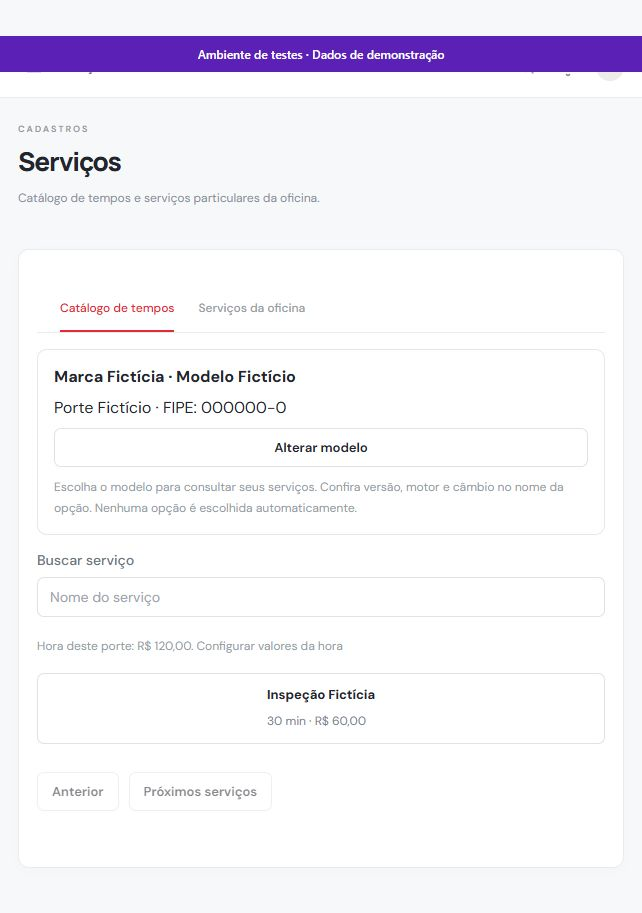](./capturas/09-cadastros-servicos/servicos-modelo-ficticio.png)

Estado: capturada · mobile · captura 2026-10-30 · commit de origem: 3792b567510404220727ed26137e813eb84bc96e · [arquivo completo](./capturas/09-cadastros-servicos/servicos-modelo-ficticio.png)

### Serviços particulares

Lista sem serviços próprios cadastrados.

[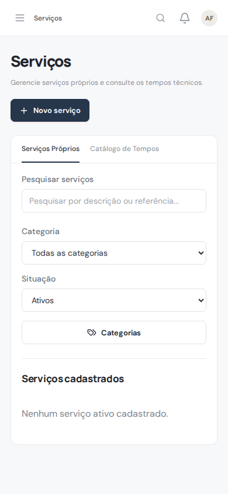](./capturas/09-cadastros-servicos/servicos-oficina.png)

Estado: capturada · mobile · captura 2026-10-30 · commit de origem: 3792b567510404220727ed26137e813eb84bc96e · [arquivo completo](./capturas/09-cadastros-servicos/servicos-oficina.png)

### Profissionais

Lista vazia na demonstração.

Estado: capturada · mobile · captura 2026-10-22 · commit de origem: não registrado · [arquivo completo](./capturas/09-cadastros-servicos/profissionais.png)

### Catálogo de tempos

Modelo e serviço fictícios disponíveis para consulta.

[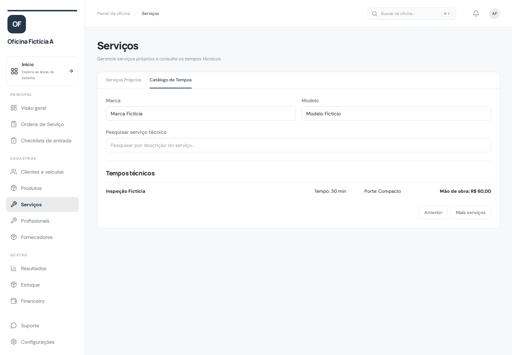](./capturas/09-cadastros-servicos/catalogo-tempos-desktop.png)

Estado: capturada · desktop · captura 2026-10-30 · commit de origem: 3792b567510404220727ed26137e813eb84bc96e · [arquivo completo](./capturas/09-cadastros-servicos/catalogo-tempos-desktop.png)

### Serviços do modelo fictício

Serviço de demonstração e duração de referência.

Estado: capturada · desktop · captura 2026-10-30 · commit de origem: 3792b567510404220727ed26137e813eb84bc96e · [arquivo completo](./capturas/09-cadastros-servicos/servicos-modelo-ficticio-desktop.png)

### Serviços particulares

Lista sem serviços próprios cadastrados.

[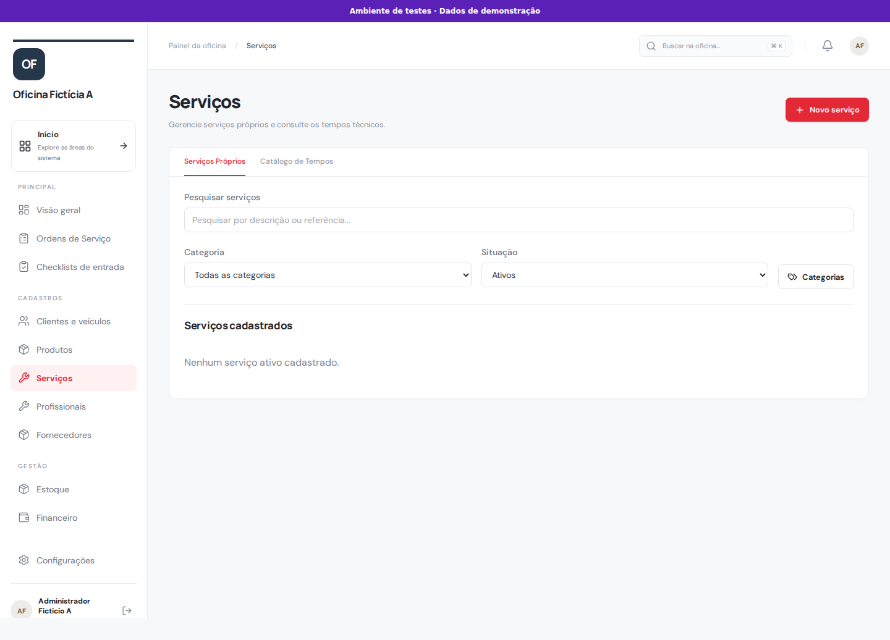](./capturas/09-cadastros-servicos/servicos-oficina-desktop.png)

Estado: capturada · desktop · captura 2026-10-30 · commit de origem: 3792b567510404220727ed26137e813eb84bc96e · [arquivo completo](./capturas/09-cadastros-servicos/servicos-oficina-desktop.png)

### Catálogo de Tempos em Serviços

Consulta técnica por marca, modelo e serviço.

Estado: capturada · desktop · captura 2026-10-30 · commit de origem: 3792b567510404220727ed26137e813eb84bc96e · [arquivo completo](./capturas/09-cadastros-servicos/catalogo-tempos-servicos-desktop.png)

### Catálogo de Tempos em Serviços

Consulta técnica por marca, modelo e serviço.

[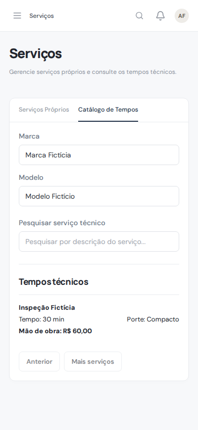](./capturas/09-cadastros-servicos/catalogo-tempos-servicos-mobile.png)

Estado: capturada · mobile · captura 2026-10-30 · commit de origem: 3792b567510404220727ed26137e813eb84bc96e · [arquivo completo](./capturas/09-cadastros-servicos/catalogo-tempos-servicos-mobile.png)

## 10 — Estoque

Saldos e movimentações de produtos.

### Saldos de estoque

Nenhum produto em estoque na demonstração.

[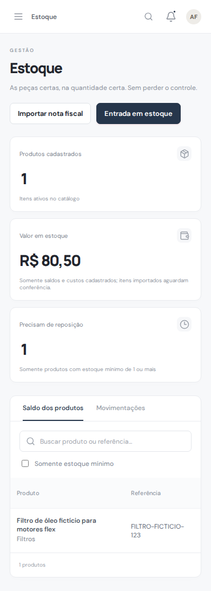](./capturas/10-estoque/saldos.png)

Estado: capturada · mobile · captura 2026-10-22 · commit de origem: não registrado · [arquivo completo](./capturas/10-estoque/saldos.png)

### Movimentações de estoque

Nenhuma movimentação registrada na demonstração.

[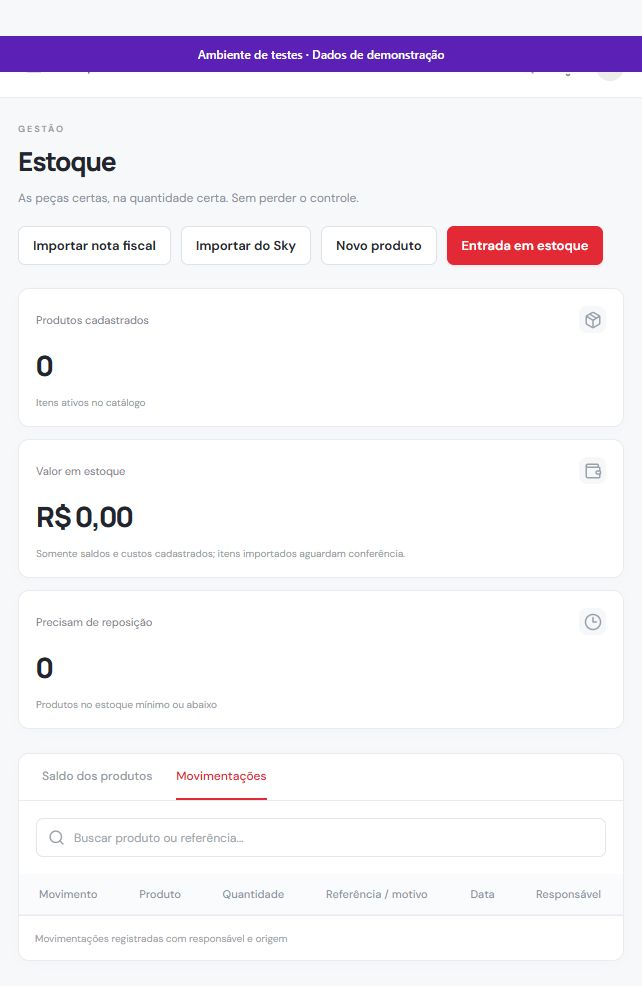](./capturas/10-estoque/movimentacoes.png)

Estado: capturada · mobile · captura 2026-10-22 · commit de origem: não registrado · [arquivo completo](./capturas/10-estoque/movimentacoes.png)

## 11 — Fornecedores

Cadastro, lista e edição de fornecedores.

### Fornecedores

Lista vazia na demonstração.

[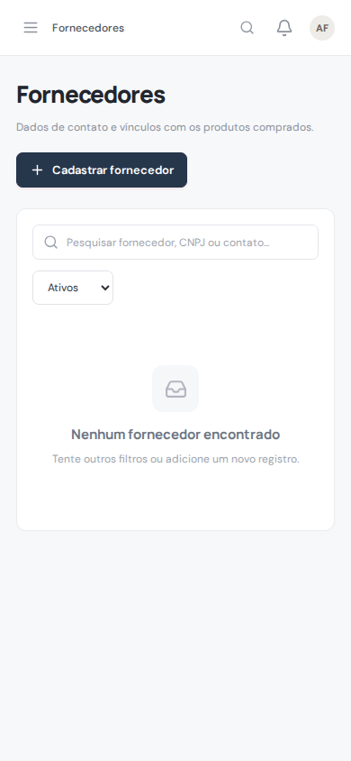](./capturas/11-fornecedores/lista-fornecedores.png)

Estado: capturada · mobile · captura 2026-10-22 · commit de origem: não registrado · [arquivo completo](./capturas/11-fornecedores/lista-fornecedores.png)

## 12 — Documentos e compartilhamento

Documentos de OS e visualização compartilhada.

Sem imagens reais disponíveis nesta área.

## 13 — Transferência de dados

Importação e restauração no painel central.

Sem imagens reais disponíveis nesta área.

## 14 — Configurações da oficina

Identidade, taxas, mão de obra e preços.

### Dados da Oficina Fictícia A

Identificação e prévia da oficina de teste.

[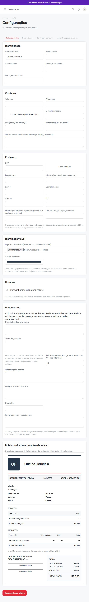](./capturas/14-configuracoes/dados-oficina-a.png)

Estado: capturada · mobile · captura 2026-10-22 · commit de origem: não registrado · [arquivo completo](./capturas/14-configuracoes/dados-oficina-a.png)

### Geral e taxas

Configurações gerais da conta local, sem alteração.

[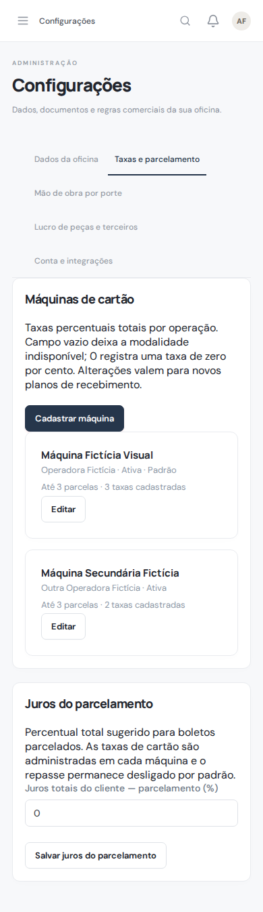](./capturas/14-configuracoes/geral-e-taxas.png)

Estado: capturada · mobile · captura 2026-10-22 · commit de origem: não registrado · [arquivo completo](./capturas/14-configuracoes/geral-e-taxas.png)

### Mão de obra por porte

Valores de referência sem alteração.

[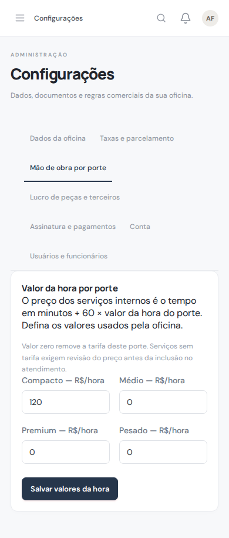](./capturas/14-configuracoes/mao-de-obra.png)

Estado: capturada · mobile · captura 2026-10-22 · commit de origem: não registrado · [arquivo completo](./capturas/14-configuracoes/mao-de-obra.png)

### Lucro de peças e terceiros

Regras e simulação exibidas no ambiente local.

[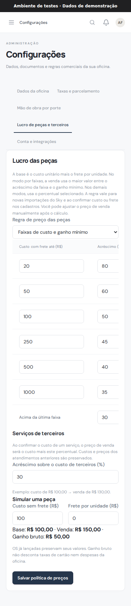](./capturas/14-configuracoes/lucro-pecas-terceiros.png)

Estado: capturada · mobile · captura 2026-10-22 · commit de origem: não registrado · [arquivo completo](./capturas/14-configuracoes/lucro-pecas-terceiros.png)

## 15 — Integrações e extensão Chrome

Captura e envio de dados pela extensão.

Sem imagens reais disponíveis nesta área.

## 16 — Erros e estados especiais

Carregamento, vazio, falha, sucesso e bloqueios.

Sem imagens reais disponíveis nesta área.

## 17 — Painel Administrativo Central

Login, oficinas, administradores e auditoria; sessão separada.

### Login do Painel Administrativo Central

Formulário vazio; nenhuma credencial ou código MFA aparece na captura.

[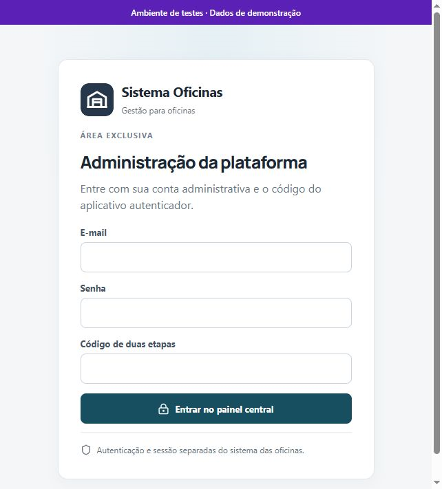](./capturas/17-painel-admin-central/login-admin-central.png)

Estado: capturada · mobile · captura 2026-10-22 · commit de origem: não registrado · [arquivo completo](./capturas/17-painel-admin-central/login-admin-central.png)

### Acessos e permissões da oficina

ADM-002.2: consulta externa de placas liberada independentemente do catálogo. Interface real em Chromium com API fictícia; backend validado separadamente.

[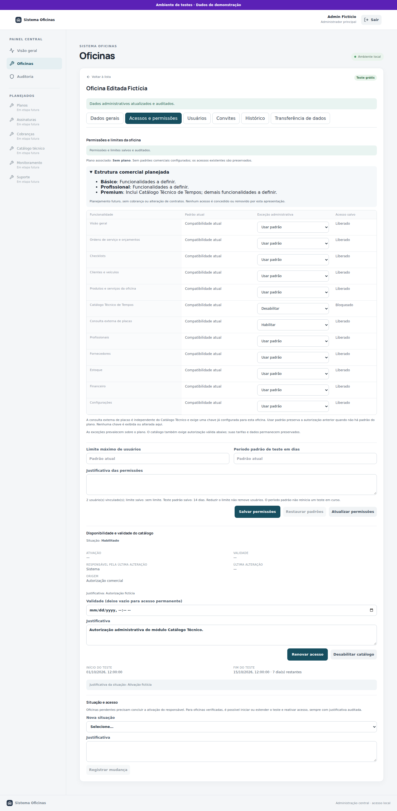](./capturas/17-painel-admin-central/adm0021-oficina-permissoes-desktop.png)

Estado: capturada · desktop · captura 2026-11-01 · commit de origem: 2708c7c44e1db1c0938fbf03b17ff9ab8e7f1069 · [arquivo completo](./capturas/17-painel-admin-central/adm0021-oficina-permissoes-desktop.png)

### Convites e ativação no celular

Interface real da ADM-002.1 em Chromium, com API fictícia interceptada; integração PostgreSQL validada separadamente.

Estado: capturada · mobile · captura 2026-10-30 · commit de origem: fdbee764e0dfdcaeb7698131779d52a4a8a6a4a8 · [arquivo completo](./capturas/17-painel-admin-central/adm0021-oficina-convites-mobile.png)

### Dados gerais no celular

Interface real da ADM-002.1 em Chromium, com API fictícia interceptada; integração PostgreSQL validada separadamente.

Estado: capturada · mobile · captura 2026-10-30 · commit de origem: fdbee764e0dfdcaeb7698131779d52a4a8a6a4a8 · [arquivo completo](./capturas/17-painel-admin-central/adm0021-oficina-dados-mobile.png)

### Proprietários e colaboradores

Interface real da ADM-002.1 em Chromium, com API fictícia interceptada; integração PostgreSQL validada separadamente.

Estado: capturada · desktop · captura 2026-10-30 · commit de origem: fdbee764e0dfdcaeb7698131779d52a4a8a6a4a8 · [arquivo completo](./capturas/17-painel-admin-central/adm0021-oficina-usuarios-desktop.png)

## 99 — Fluxos completos

Sequências de navegação entre áreas.

Ainda sem interações mapeadas nesta versão.

## 99 — Fluxos completos

### FL-001 — Login → dashboard

Autenticar uma oficina fictícia e abrir a visão geral.

1. Login da oficina (capturada) — [imagem](./capturas/01-login-acesso/login-oficina.png)
2. Início da Oficina Fictícia A (capturada) — [imagem](./capturas/02-dashboard/inicio-oficina.png)
3. Visão geral da Oficina Fictícia A (capturada) — [imagem](./capturas/02-dashboard/dashboard-oficina.png)

Estado: pendente — Há imagens reais individuais; o encadeamento completo ainda não foi capturado na execução Playwright.

### FL-002 — Cliente → veículo

Cadastrar cliente fictício e associar veículo no mesmo atendimento de teste.

1. Clientes da Oficina Fictícia A (capturada) — [imagem](./capturas/03-clientes/clientes-lista-oficina-a.png)
2. Veículos da Oficina Fictícia A (capturada) — [imagem](./capturas/04-veiculos/veiculos-lista-oficina-a.png)
3. Cadastro de cliente (pendente)
4. Cadastro e seleção de veículo (pendente)

Estado: pendente — As telas de lista foram capturadas; nenhum cadastro foi criado na coleta original.

### FL-003 — Checklist → orçamento

Iniciar a recepção e converter os dados em orçamento.

1. Novo checklist (capturada) — [imagem](./capturas/05-checklist/novo-checklist.png)
2. Checklist preenchido e evidências (pendente)
3. Novo orçamento (capturada) — [imagem](./capturas/06-orcamentos/novo-orcamento.png)
4. Orçamento com produtos e serviços (pendente)

Estado: pendente — A coleta original não salvou OS, checklist ou orçamento.

### FL-004 — Orçamento → OS → recebimento

Avançar por aprovação, execução, finalização e recebimento simulado.

1. Novo orçamento (capturada) — [imagem](./capturas/06-orcamentos/novo-orcamento.png)
2. Detalhe de ordem de serviço (pendente)
3. Execução e mudança de status da OS (pendente)
4. Finalização e recebimento (pendente)

Estado: pendente — Não executado: exige registros transitórios da base isolada.

### FL-005 — Produtos → serviços → estoque

Cadastrar itens fictícios e registrar uma movimentação de estoque.

1. Produtos (capturada) — [imagem](./capturas/09-cadastros-servicos/produtos.png)
2. Cadastro e edição de serviço (pendente)
3. Entrada e saída de estoque (pendente)

Estado: pendente — As listas reais estão registradas; as gravações e movimentações não foram executadas.

### FL-006 — Documentos e compartilhamento

Emitir documento de OS e abrir link público de teste.

1. Documento emitido e reimpressão (pendente)
2. Visualização compartilhada (pendente)

Estado: pendente — Sem token público de teste disponível na coleta inicial.

### FL-007 — Transferência de dados

Pré-visualizar fixture fictícia e validar resultado sem gravar em ambiente remoto.

1. Prévia da transferência (pendente)
2. Validação e confirmação da transferência (pendente)

Estado: pendente — Executar somente em ambiente descartável; nunca usar o Supabase de homologação compartilhado.
